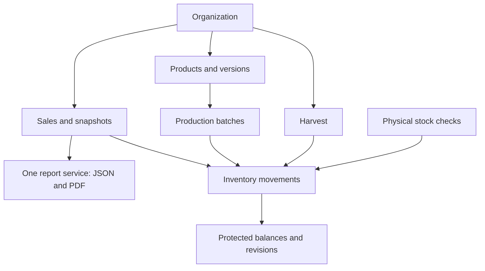

# Architecture mapped before implementation

## System rule
BEFORE APPLYING ANY CHANGE, IDENTIFY WHICH DOMAINS, DATABASE INVARIANTS, API CONTRACTS, REPORTS, SECURITY BOUNDARIES, AND CLIENTS ARE AFFECTED. A CHANGE IS NOT COMPLETE UNTIL ITS SYSTEM-WIDE IMPACT HAS BEEN REVIEWED.

React/Vite and Flutter/Dart are REST clients. Express/TypeScript is a modular monolith. Drizzle executes parameterized PostgreSQL queries on node-postgres; Neon is the production database. Filebase S3-compatible storage keeps validated images, Brevo delivers email, and web-push delivers browser notifications. No marketplace API, internal checkout, offline write queue, demo records, or simulated provider success exists.

## Transaction boundary and concurrency
Every organization mutation locks the organization row first, revalidates the actor, checks an idempotency record, performs domain writes, writes audit, and commits together. This deliberately serializes a small group's writes and avoids cross-domain lock-order races. Different organizations remain independent. Inventory insertion additionally uses a database trigger to lock/update the item balance and revision; a CHECK forbids negative balances. The append-only movement ledger is authoritative. Cached balances can be verified by summing movements.

## Resolved domain decisions
* Raw quantities are integral grams; finished output is integral units; money is integral Rupiah. REST uses decimal strings for BIGINT, and calculations use BigInt, including half-up rounding for Grade A prices per kilogram.
* Draft harvest may be partially classified. Finalization must balance and emits two grade movements. Void emits exact reversals and requires available stock; a replacement is a new harvest.
* Plans reserve planning capacity only. Physical production consumes the actual quantity and emits actual output; theoretical material is a snapshot, never an equality constraint. A selected plan becomes completed. If remaining plans exceed physical stock after production, opname or a correction, those plans become NEEDS_REVIEW and stop reserving capacity. This is visible and audited; physical facts take precedence.
* Product economics are append-only complete versions. Historical sales keep their own names, price, HPP, line totals, and version ID. Grade A captures per-kg rates. Backdated entry uses economics selected at entry; an explicit sale price can represent the actual past deal.
* A void restores/reverses movements and excludes the original from financial totals while retaining original lines and reasons. Production/harvest void cannot make inventory negative. There is no delete API for financial events.
* Opname locks one active count per item. Its baseline includes balance and revision. Completion rejects stale revisions even if stock returned to the same number. Refresh is explicit and requires recounting.
* An organization-wide daily sales acknowledgement is a reminder acknowledgement, not a financial close. A later sale changes NO_SALES to COMPLETED. Reminders use the organization's timezone and local clock; no hard close blocks late transactions.
* Reports and PDF call one reporting service, using sale-line snapshots and stored line totals. Voids restate the original business-date report; this is operational bookkeeping, not a closed-period general ledger.

## Security boundaries
Public routes select named public fields and published rows for a configured organization slug. Private routes obtain organization from a live server session, never request body. OWNER alone invites/deactivates ADMIN and changes settings. SUPER_ADMIN exists only for intentional CLI provisioning and cannot be assigned by organization APIs. HttpOnly cookies carry opaque random sessions; hashed session/reset/invitation tokens live server-side. Origin checks and per-session CSRF protect writes. All image access checks publication or a scoped session before issuing short-lived signed access.

## Relationships

Composite organization/entity foreign keys prevent cross-organization relationships. Users are single-organization in V1; organization switching is deliberately absent. All critical mutations require an idempotency key bound to actor, operation and canonical request hash. A retry replays the original JSON; reusing a key for another request fails. There is no automatic client mutation retry. Users can manually retry uncertain saves with the same in-memory key.

## Integrations and mobile
External calls have timeouts and configuration gates. No server credentials are sent to React or Flutter. Missing Neon makes database operations unavailable; missing Filebase/Brevo/VAPID disables the dependent action with an explicit error. Email token issuance uses a bounded transaction and commits only after real provider acceptance. Provider acceptance is distinct from inbox delivery. Notifications are a small database-backed scheduled job inside the monolith, with external cron support.

PWA caches only immutable same-origin assets and an offline notice. API, dashboard HTML, and writes are never cached or queued. The Flutter client in `apps/mobile` uses the same domain services and `/api/v1` contract. Mobile transport/session handling stays at the adapter boundary and must not fork business logic. Native transactional writes are not queued offline.
