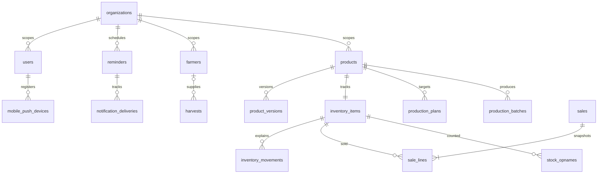

# Database design and migrations

PostgreSQL 17+ / Neon is the persistent production database. `0001_initial.sql` is the authoritative initial schema, including foreign keys, partial indexes, generated money columns and PL/pgSQL guards. Drizzle's node-postgres driver executes parameterized SQL. Explicit SQL is used to keep locking and ledger semantics visible rather than hiding them behind a generic repository layer.

Migration execution is intentional: `npm run db:migrate`, or `npm run db:migrate:prod` after building. It obtains a transaction advisory lock, creates `schema_migrations`, checks every applied file's SHA-256, applies pending files in order, and commits atomically. Never edit a migration after applying it to an environment; create an additive migration instead. Use `DATABASE_MIGRATION_URL` with DDL privileges, preferably a direct Neon connection.

## Entity relationships

Every business table has `org_id`, or is the organization itself. Composite `(org_id,id)` uniqueness allows composite FKs for farmer, product, economics version, item, file, plan and sale references. This prevents an entity from organization A being attached to a record of B, even if IDs become known. Actors are linked globally for audit because the platform provisioner has no organization; normal services revalidate actor organization and role under the organization lock.

Key constraints: nonnegative balance; positive operational quantities; harvest classification bounds/final equality; valid statuses; discount+fees ≤ gross; valid item kind/product combination; valid sale-line version references; one active opname per item; one production batch per plan; unique SKU per organization; unique actor idempotency keys. `net_rp` and version `hpp_rp` are generated from integer components.

Migration `0004_mobile_push.sql` adds authenticated mobile device registration through `mobile_push_devices`, with a unique Firebase Installation ID and explicit Android/iOS platform. Migration `0005_mobile_push_delivery.sql` extends durable notification delivery tracking so `MOBILE_PUSH` is independent from browser `PUSH` and `EMAIL`.

Movement insertion validates its source, then updates balance/revision through a trigger. Direct balance rewriting and item identity changes are forbidden. Movements, economics versions, sale lines and audit are immutable. Event-header guards preserve finalized harvest and completed sale/production economics, allowing only an explicit status/reason void.

Use separate migration and runtime roles. Runtime needs only normal SELECT/INSERT/UPDATE/DELETE privileges, never ownership, DDL, superuser or trigger-disabling privileges. Do not treat database-owner credentials as an application authorization boundary. See deployment for grant guidance and backups.
